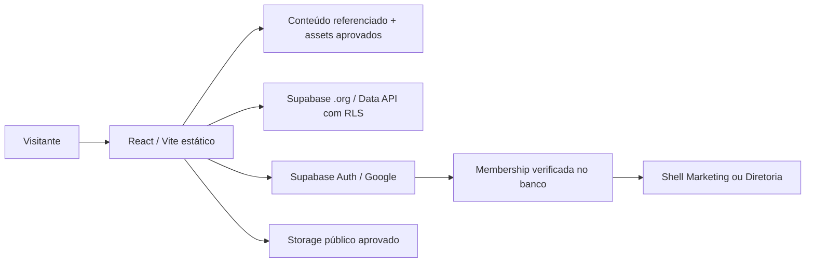

# Arquitetura

`config.ts` valida exatamente o projeto dedicado, chave pública e destinos internos; `backend.ts` centraliza cliente e contratos. Não há fallback para o banco comercial. Sem configuração, o público pode navegar; o login não simula acesso e consultas não retornam dados fabricados.

Conteúdo atemporal referenciado tem fallback no frontend. Notícias, documentos aprovados e declarações oficiais são lidos da nova Data API; seed inicial conserva a proveniência. Edição de conteúdo, upload e fluxos financeiros não são implementados no shell da V0.

Notícias: consulta paginada de 24 registros, busca `websearch` PostgreSQL em índice GIN de título/resumo, filtro e ordenação no servidor. Artigos usam Markdown com HTML desativado, links HTTPS validados e sem imagens arbitrárias. Importação é processo administrativo explícito com dry-run.

Auth usa cliente oficial, PKCE, sessão recuperada e `getUser()`. Membership ativa vem de RLS. Eventos de sessão, foco e revalidação periódica removem conteúdo de área privada enquanto verificam autorização. RLS protege dados mesmo se a UI for alterada.

PDF.js é carregado sob demanda; somente a página atual é renderizada, com DPR limitado a 2. Exportação PNG depende do documento e da renderização completa. O PDF fornecido é rasterizado e sua acessibilidade interna não equivale a um PDF com texto semântico.

Base configurável: `/` local/hosting próprio; `/InstitutoFoton.org/` no Pages. `404.html` transporta path/query/hash para index, que restaura a URL antes do React. Não usa hash como roteador. Limitação: a primeira resposta HTTP de uma rota desconhecida no Pages é 404; após restauração a aplicação funciona. Migração para hosting com rewrite elimina essa limitação.

SEO: título por rota, canonical por origem configurada, Open Graph estático, sitemap/robots do build. SPA sem SSR: metadados específicos de artigo dependem de JS; pré-renderização é evolução recomendada.
