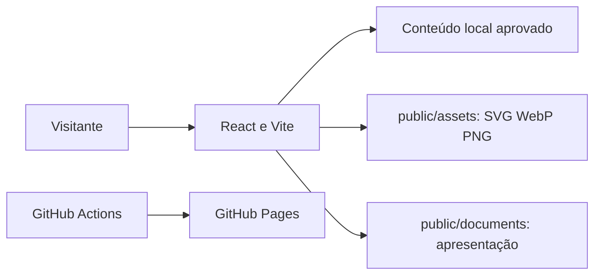

# Arquitetura atual — portal estático

O InstitutoFoton.org é uma aplicação **React/Vite** publicada como site estático. O navegador consome conteúdo JSON/TypeScript local, imagens SVG, WebP, PNG e PDF aprovados. **Não há backend, autenticação institucional ou banco de dados associado a este portal.**

- Fontes editoriais: `code/src/content/`; `code/src/lib/backend.ts` implementa consultas **locais**.
- Mídia pública: `code/public/assets/`. Documentos públicos aprovados: `code/public/documents/`.
- Inventários e relatórios técnicos: `code/scripts/data/`, fora do diretório publicado.
- Parceiros: 31 SVGs autorizados, tanto originais (`assets-svg`) quanto derivados (`display-svg`).
- PDF: visualizador PDF.js sob demanda, com suas limitações de acessibilidade para documentos rasterizados.
- Publicações: catálogo local, vazio enquanto não houver materiais aprovados.
- Base configurável: `/InstitutoFoton.org/` no Pages e `/` em hosting próprio. `404.html` preserva path, query e hash, mas a primeira resposta HTTP para rotas profundas pode ser 404 no Pages.
- SEO: títulos e canonical de rotas gerados localmente, sem SSR.

Qualquer API, CMS ou autenticação futura exige projeto e revisão arquitetural próprios. A arquitetura de serviços remotos anterior foi descontinuada.
